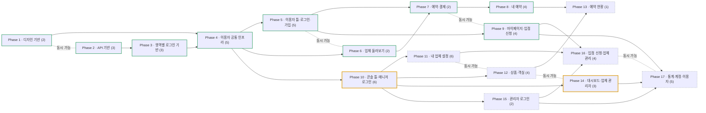

# Roadmap — roomless-frontend (지침서 화면 25개를 공통 기반 → 이용자 → 업체 관리자 → 관리자 순으로)

## Direction
백엔드 Phase 27 지침서(`frontend/`)의 화면 25개(U1~U11 · M1~M8 · A1~A6)를 시안(아티팩트)대로 만든다. 공통 기반(디자인 · API 호출 · 영역별 로그인)을 먼저 깔고, **이용자 화면을 먼저**, 그 뒤 업체 관리자 콘솔, 관리자 콘솔 순서로 간다(선택: 사용자 2026-11-13). 순서와 범위는 언제든 바뀔 수 있다.

## 한눈에 보는 흐름

- Phase 1 — 디자인 기반 · 유닛 2개 · 의존: — · 푼다: Phase 4 · 파일 집합: src/app/css, src/shared/components/ui, src/shared/css · done
- Phase 2 — API 기반 · 유닛 3개 · 의존: — · 푼다: Phase 3 · 파일 집합: src/shared/api, src/contracts/common, src/shared/utils · done
- Phase 3 — 영역별 로그인 기반 · 유닛 3개 · 의존: Phase 2 · 푼다: Phase 4 · 파일 집합: src/app/api/cookie, src/shared/api(auth), src/shared/providers, src/app/RootLayoutContent.tsx · done
- Phase 4 — 이용자 공통 인프라 · 유닛 5개 · 의존: Phase 1, Phase 3 · 푼다: Phase 5, Phase 6, Phase 10 · 파일 집합: src/shared/components(map·sms·upload), src/shared/payment, src/app/api/payments · done
- Phase 5 — 이용자 틀·로그인·가입 · 유닛 5개 · 의존: Phase 4 · 푼다: Phase 7, Phase 9 · 파일 집합: src/app/(user)/layout · login · signup · phone-verification · find-login-id, src/app/api/auth, src/contracts/user · done
- Phase 6 — 업체 둘러보기 · 유닛 2개 · 의존: Phase 4 · 푼다: Phase 7 · 파일 집합: src/app/(user)/page · stores/[store_id], src/contracts/discovery · done
- Phase 7 — 예약·결제 · 유닛 2개 · 의존: Phase 5, Phase 6 · 푼다: Phase 8 · 파일 집합: src/app/(user)/stores/[store_id]/booking · payments, src/contracts/reservation · done
- Phase 8 — 내 예약 · 유닛 4개 · 의존: Phase 7 · 푼다: Phase 13 · 파일 집합: src/app/(user)/reservation, src/contracts/reservation · done
- Phase 9 — 마이페이지·입점 신청 · 유닛 4개 · 의존: Phase 5 · 푼다: Phase 16, Phase 17 · 파일 집합: src/app/(user)/me · store-applications, src/contracts/user, src/contracts/store · done
- Phase 10 — 콘솔 틀·매니저 로그인 · 유닛 6개 · 의존: Phase 4 · 푼다: Phase 11, Phase 12, Phase 14, Phase 15 · 파일 집합: src/shared/components/console, src/app/manager, src/contracts/manager · in-progress
- Phase 11 — 내 업체 설정 · 유닛 6개 · 의존: Phase 10 · 푼다: Phase 16 · 파일 집합: src/app/manager/(console)/store, src/contracts/store · todo
- Phase 12 — 상품·객실 · 유닛 4개 · 의존: Phase 10 · 푼다: Phase 13 · 파일 집합: src/app/manager/(console)/plans · room-groups · rooms, src/contracts/room · todo
- Phase 13 — 예약 현황 · 유닛 1개 · 의존: Phase 12, Phase 8 · 푼다: — · 파일 집합: src/app/manager/(console)/reservations, src/contracts/reservation · todo
- Phase 14 — 대시보드·업체 관리자 · 유닛 3개 · 의존: Phase 10 · 푼다: Phase 17 · 파일 집합: src/app/manager/(console)/page · staff, src/contracts/stats, src/contracts/manager · in-progress
- Phase 15 — 관리자 로그인 · 유닛 2개 · 의존: Phase 10 · 푼다: Phase 16, Phase 17 · 파일 집합: src/app/admin/login · (console)/layout · password, src/contracts/admin · todo
- Phase 16 — 입점 신청·업체 관리 · 유닛 4개 · 의존: Phase 15, Phase 11, Phase 9 · 푼다: — · 파일 집합: src/app/admin/(console)/store-applications · stores, src/contracts/store · todo
- Phase 17 — 통계·계정·이용자 · 유닛 5개 · 의존: Phase 15, Phase 14, Phase 9 · 푼다: — · 파일 집합: src/app/admin/(console)/page · managers · users, src/contracts/stats · manager · user · todo

동시 가능: Phase 1·Phase 2 / Phase 5·Phase 6 / Phase 7·Phase 9 / Phase 11·Phase 12·Phase 14 / Phase 16·Phase 17

지금: Phase 10, Phase 14 진행 중 · Next up: Phase 10

## 지금 할 일
Phase 10 콘솔 틀·매니저 로그인 시작하기
- #31 콘솔 틀
- #32 M1 업체 로그인
- #33 M1 아이디 찾기
- #34 M1 비밀번호 초기화
- #35 M1 업체 로그인 주소 안내
- #36 M1 비밀번호 변경
- ok → 다음

## Scope & Actors
- **이용자** (모바일 웹 `/`, 카카오 · 네이버 로그인) — 주변 업체 찾기 → 예약 · 토스 결제 → QR 입실 · 취소 · 연장, 마이페이지 · 탈퇴, 입점 신청.
- **업체 총관리자(HEAD_MANAGER) · 매니저(MANAGER)** (PC 콘솔 `/manager`, 업체코드가 든 로그인 주소) — 대시보드 · 예약 현황 · 호실 · 객실 그룹 · 상품 · 내 업체 설정. 업체 관리자 관리 · 문 시크릿은 총관리자만.
- **총관리자 · 관리자** (PC 콘솔 `/admin`) — 입점 신청 승인 · 반려, 업체 · 업체 관리자 · 이용자 관리, 전체 통계.
- **시스템(백엔드)** — SMS 링크로 U7(QR 확인) · U8(취소 동의)를 연다.
- **업체마다 다른 것(맞춤 축)** — 판매 상품(시간 이용 · 1박 · 연박)과 판매 요일 · 시간, 영업시간 · 브레이크, 운영 규정(정비시간 · 예약 오픈 · 환불 마감 · 비율), 객실 그룹 · 편의시설 · 그룹 가격 · 기간 가격, 사진, 일시 예약불가, 문 연동 시크릿, 업체코드(로그인 주소). 화면은 이 값을 그대로 그리고 고친다 — 계산은 백엔드.

## Non-Goals / External Boundaries
- 백엔드 API · DTO 변경은 백엔드 몫 — 바뀌면 `frontend/changes/` 로 오고, 영향 화면 phase 에 유닛을 더한다.
- 화면 디자인은 새로 만들지 않는다 — 시안(`frontend/design/*.html`)의 배치 · 색 · 간격을 옮긴다.
- 결제 승인 판단 · 금액 대조 · 환불 계산은 백엔드. 프론트는 토스 결제창과 승인 API 중계(Next.js 서버)만.
- SMS 발송 · 문 하드웨어 · 문 쪽 프로그램은 백엔드 / 업체 책임.
- 네이티브 앱 · 다국어 · 자동 E2E 테스트는 범위 밖.

## Phases & Units

### Phase 1 — 디자인 기반 (시안의 색 · 글꼴 · 기본 UI 를 코드로) · depends: —
| # | Unit | Goal | Key decision | Depends | Status |
|---|------|------|--------------|---------|--------|
| 1 | 디자인 토큰 · 전역 CSS · 글꼴 | 시안 `:root` 변수(색 · 간격 · 그림자)를 전역 토큰으로, Noto Sans KR 을 `next/font` 로 | 토큰을 전역 하나 vs 이용자 · 콘솔로 나눌지(변수 이름이 영역마다 조금 다름) | — | done(a32706e) |
| 2 | 공통 UI 컴포넌트 | 버튼 · 입력 · 배지 · 탭 · 모달(확인 · 사유 입력) · 빈 상태 · 복사 버튼 — 25개 화면이 같이 씀 | 모달을 `<dialog>` 로 할지 포털로 할지 | 1 | done(a32706e) |

**Expected modules**:

| Unit | Module | Export | Purpose |
|------|--------|--------|---------|
| #1 | `src/app/css/globals.css` · `src/app/layout.tsx` | 색 한 벌 · 크기 `data-area` · Noto Sans KR | 시안 값 그대로 |
| #2 | `src/shared/components/ui/<종류>/` · `src/shared/css/ui/` | `Button` · `Input` · `Textarea` · `Field` · `Badge` · `Band` · `Switch` · `Chip` · `Segmented` · `Tabs` · `Card` · `Table` · `EmptyState` · `Modal` · `ConfirmModal` · `ReasonModal` · `RouteModal` · `CopyButton` | 화면 공통 부품 |
| #2 | `src/app/@modal/` · `/dev/ui` | 경로 모달 슬롯 · 개발 전용 미리보기 | 경로 모달 규칙 · 확인 |

> build 완료(2026-11-14) — report: `.beaver/output/report/ui/design-foundation-report.md`. 테스트는 `/beaver:test`, 화면은 `npm run dev` 후 `/dev/ui/`.

### Phase 2 — API 기반 (지침서 호출 방식 · 공통 계약 · 표시 형식) · depends: —
| # | Unit | Goal | Key decision | Depends | Status |
|---|------|------|--------------|---------|--------|
| 3 | 백엔드 호출 클라이언트 | 동기 JSON · 큐(SSE: accepted → done / failed / pending) 호출, 실패 본문(`validation_errors` snake_case)을 칸 · alert 로 — 예전 axios 래퍼 · `axios-error` 교체 | axios 유지 + 큐만 fetch vs fetch 하나로 통일 | — | done(3e1555f) |
| 4 | 공통 계약 | `contracts/common`(페이지 · 실패 DTO · 상태 상수 · 룩업 · 큐 이벤트 이름) 사본 + `class-transformer`, `PaginationType`/`Pagination` 을 snake_case 로 | — | 3 | done(3e1555f) |
| 5 | 표시 형식 유틸 | ISO 시각 → 한국 시각, 날짜 · 달 · `HH:mm`, 금액(원), 요일 비트합 ↔ 요일 목록, 상태 이름(`*_name` → 룩업) | dayjs timezone 플러그인을 쓸지 | — | done(3e1555f) |

**Expected modules**:

| Unit | Module | Export | Purpose |
|------|--------|--------|---------|
| #3 | `src/shared/api/` | `request` · `callQueue` · `takeSseEvents` · `handleApiError` · `ApiError` | 동기 · 큐 호출과 실패 처리 (fetch 하나) |
| #4 | `src/contracts/common/` · `src/shared/components/ui/nav/Pagination.tsx` | `pagination.dto` · `fail-result.dto` · `roles` · `sse` · `reservation.constants` · `lookup` · `Pagination` | 지침서 `frontend/dto/common.md` 사본 · 페이지 탭 |
| #5 | `src/shared/utils/format.ts` | `toKst` · `todayKst` · `formatPrice` · `daysToBits` · `bitsToDays` · `formatDays` | 화면 표시 |

> build 완료(2026-11-15) — report: `.beaver/output/report/api/api-foundation-report.md`. fetch 하나로 통일, `class-transformer` 는 쓰는 곳이 생기는 Phase 5 로 미룸. 테스트는 `/beaver:test`, 페이지 탭은 `/dev/ui/`.

### Phase 3 — 영역별 로그인 기반 (이용자 · 매니저 · 관리자 토큰을 따로) · depends: Phase 2
| # | Unit | Goal | Key decision | Depends | Status |
|---|------|------|--------------|---------|--------|
| 6 | 영역별 토큰 저장 · 로그아웃 | 세 영역 토큰을 httpOnly 쿠키로 따로 저장 · 삭제(route handler) — 예전 단일 `accessToken` 쿠키 교체 | 쿠키를 이름으로 나눌지 경로(path)로 나눌지 | 3 | done(e80e459) |
| 7 | 401 재발급 · 로그인으로 보내기 | 401 → 그 영역 `token-refresh` 한 번 → 또 401 이면 그 영역 로그인 화면(돌아올 주소와 함께) | 재발급을 브라우저에서 할지 Next 서버(route handler)에서 할지 | 3, 6 | done(e80e459) |
| 8 | 영역 판별 · 로그인 상태 · AuthGuard | 주소로 영역을 알아 그 영역 로그인 상태를 Context 로, `AuthGuard` 를 영역별 로그인 주소로 — `RootLayoutContent` 정리 | — | 6, 7 | done(e80e459) |

**Expected modules**:

| Unit | Module | Export | Purpose |
|------|--------|--------|---------|
| #6 | `src/app/api/cookie/[area]/…` · `token-cookie.ts` · `src/shared/api/cookie.ts` | `GET` · `POST` · `DELETE` · `saveAreaTokens` · `deleteAreaTokens` | 영역 토큰 읽기 · 쓰기 · 지우기 |
| #7 | `src/shared/api/auth.ts` · `src/app/api/cookie/[area]/refresh/` · `src/contracts/{user,manager,admin}/api.ts` | `withAuth` · `refreshAreaToken` · `LoginRequiredError` | 401 재발급 |
| #8 | `src/shared/utils/area.ts` · `src/shared/providers/` · `src/shared/components/AuthGuard.tsx` | `areaOf` · `loginUrl` · `AuthContext` · `AuthGuard` | 영역별 로그인 상태 · 보호 |

> build 완료(2026-11-16) — report: `.beaver/output/report/auth/area-auth-report.md`. 함께: 오류 alert → 오류 팝업, 테스트 `src/test/`, lint 정리. 테스트는 `/beaver:test`, lint 는 `npm run lint`.

### Phase 4 — 이용자 공통 인프라 (지도 · 주소 · 인증번호 · 파일 · 결제) · depends: Phase 1, Phase 3
| # | Unit | Goal | Key decision | Depends | Status |
|---|------|------|--------------|---------|--------|
| 9 | 지도 확장 | 여러 마커 · 지도를 멈추면 중심 좌표 알림 · 내 위치(거부면 기본 위치) — U1 · U2 가 씀. 재사용: `src/shared/components/KakaoMap.tsx` | — | 1 | done(6121b5b) |
| 10 | 주소 → 좌표 | 우편번호 검색으로 주소를 고르고 카카오 지오코더로 `latitude` · `longitude` — U11 · A4 가 씀. 재사용: `src/shared/utils/address.ts` | — | 9 | done(6121b5b) |
| 11 | 인증번호 입력 흐름 | 휴대폰 번호 → 발송(큐) → 코드 입력 + 남은 시간 → 확인 — U5 · M1 네 곳이 씀. 재사용: `src/shared/components/Timer.tsx` | 발송 · 확인 API 를 props 로 받는 한 컴포넌트로 | 2 | done(6121b5b) |
| 12 | 파일 올리기 | 업로드 주소 발급 → S3 로 PUT → 등록(큐), JPG · PNG 만, 사진 목록(순서 끌기 · 삭제) — U11 · M5 · M7 이 씀 | 순서 끌기를 직접 구현할지 라이브러리를 쓸지 | 2 | done(6121b5b) |
| 13 | 토스 결제 | 결제창 열기(`payment_id` · `order_name` · `amount`) · `/payments/success` 의 서버 승인(시크릿 키) · 결제 마감 남은 시간 — U3 · U4 · U7 · U9 가 씀 | 토스 SDK 버전 · 키 보관(.env) | 1 | done(6121b5b) |

**Expected modules**:

| Unit | Module | Export | Purpose |
|------|--------|--------|---------|
| #9 | `src/shared/components/map/` | `StoreMap` · `useMyLocation` | 여러 업체 지도 |
| #10 | `src/shared/utils/address.ts` | `searchAddressWithCoords` | 주소 + 좌표 |
| #11 | `src/shared/components/sms/` | `SmsVerification` | 인증번호 흐름 |
| #12 | `src/shared/components/upload/`, `src/shared/api/upload.ts` | `ImageUploader` · `uploadFile` | 파일 3단계 |
| #13 | `src/shared/components/payment/`, `src/shared/api/payment.ts`, `src/app/api/payments/confirm/` | `TossPaymentWidget` · `requestTossConfirm` · `POST` | 결제위젯 · 승인 중계 |

> build 완료(2026-11-16) — report: `.beaver/output/report/infra/user-infra-report.md`. 결제위젯 · @dnd-kit 설치, 미리보기 `/dev/infra/`. 테스트는 `/beaver:test`, 화면은 `.env.local` 키를 넣고 `/dev/infra/`.

### Phase 5 — 이용자 틀·로그인·가입 (U5) · depends: Phase 4
| # | Unit | Goal | Key decision | Depends | Status |
|---|------|------|--------------|---------|--------|
| 14 | 이용자 모바일 틀 | `(user)` layout — 모바일 폭 · 상단 로그인 / 내 예약 진입 · 회원 상태 띠(BLOCK · LEAVE_WAIT) | — | 8 | done(be09472) |
| 15 | SNS 로그인 | `/login` 카카오 · 네이버 → `user/login` → 토큰 저장 → 휴대폰 미인증이면 `/phone-verification`, 아니면 돌아갈 주소 — 예전 아이디 · 비밀번호 로그인 교체 | next-auth 유지 vs 카카오 · 네이버 SDK 직접 | 8, 14 | done(be09472) |
| 16 | 가입 | `/signup` 성별 · 생년월일(만 19세) · 닉네임 → `user/sign`(큐) | — | 15 | done(be09472) |
| 17 | 휴대폰 인증 | `/phone-verification` 번호 → 인증번호 → 완료 | — | 11, 15 | done(be09472) |
| 18 | 아이디 찾기 | `/find-login-id` 번호 → 인증번호 → 가입한 SNS · 가입일 | — | 11 | done(be09472) |

**Expected pages**:

| Unit | Route | Screen · API | Purpose |
|------|-------|--------------|---------|
| #14 | `src/app/(user)/layout.tsx` | 이용자 틀 · `user/me` | 모바일 공통 틀 |
| #15 | `/login` | U5 로그인 · `POST user/login` | SNS 로그인 |
| #16 | `/signup` | U5 가입 · `POST user/sign` | 추가 정보 |
| #17 | `/phone-verification` | U5 휴대폰 인증 · `POST user/phone-verification` · `/confirm` | 휴대폰 인증 |
| #18 | `/find-login-id` | U5 아이디 찾기 · `POST user/find-login-id` · `/confirm` | 가입 SNS 찾기 |

> build 완료(2026-11-16) — report: `.beaver/output/report/user/user-login-report.md`. next-auth + 서버 route 로그인 · 가입, jsonwebtoken · SNS 쿠키 제거. 테스트는 `/beaver:test`, 화면은 `.env.local` 의 NEXTAUTH_SECRET · 카카오 · 네이버 키로 `/login/`.

### Phase 6 — 업체 둘러보기 (U1 · U2) · depends: Phase 4
| # | Unit | Goal | Key decision | Depends | Status |
|---|------|------|--------------|---------|--------|
| 19 | U1 지도 · 주변 업체 | `/` 지도 마커 · 반경(5 · 10 · 20 · 50km) · 업체 카드, 지도를 멈추면 다시 조회, `is_truncated` 안내 | — | 9 | done(3c13e62) |
| 20 | U2 업체 상세 + 객실 그룹 | `/stores/[store_id]` 사진 · 영업시간 · 상품 · 규정 · 객실 그룹 카드 → 예약하기 | — | 19 | done(3c13e62) |

**Expected pages**:

| Unit | Route | Screen · API | Purpose |
|------|-------|--------------|---------|
| #19 | `/` | U1 · `GET discovery/store` | 주변 업체 |
| #20 | `/stores/[store_id]` | U2 · `GET discovery/store/:store_id` · `/room-group` | 업체 상세 |

> build 완료(2026-11-16) — report: `.beaver/output/report/discovery/store-discovery-report.md`. StoreMap 핀 · 반경 원 · 내 위치, `formatDays` 범위, swiper 사진. 테스트는 `/beaver:test`, 화면은 백엔드를 켜고 `/` · `/stores/<id>/`.

### Phase 7 — 예약·결제 (U3 · U4) · depends: Phase 5, Phase 6
| # | Unit | Goal | Key decision | Depends | Status |
|---|------|------|--------------|---------|--------|
| 21 | U3 예약 | `/stores/[store_id]/booking` 상품 탭 → 달력 → 그룹 카드 넘기기 → 시간대 → 호수 → 예약(큐) → 결제창 | 달력을 직접 그릴지 라이브러리를 쓸지 | 13, 15, 20 | done(e8f8e12) |
| 22 | U4 결제 결과 | `/payments/success` · `/payments/fail` 승인 → `payment-confirm`(큐) → U7 / U3 | — | 13, 21 | done(e8f8e12) |

**Expected pages**:

| Unit | Route | Screen · API | Purpose |
|------|-------|--------------|---------|
| #21 | `/stores/[store_id]/booking` | U3 · `GET reservation/availability` · `POST reservation` | 고르기 · 예약 |
| #22 | `/payments/success` · `/payments/fail` | U4 · `POST reservation/payment-confirm` | 결제 확정 |

> build 완료(2026-11-17, Phase 8 과 함께) — report: `.beaver/output/report/reservation/booking-payment-report.md`. 직접 그린 달력 · swiper 그룹 넘기기 · 결제위젯 `returnUrl`. 토스가 `return_url` 뒤에 값을 잇는 모양은 테스트 결제로 확인.

### Phase 8 — 내 예약 (U6~U9) · depends: Phase 7
| # | Unit | Goal | Key decision | Depends | Status |
|---|------|------|--------------|---------|--------|
| 23 | U6 내 예약 목록 | `/reservation` 예약 카드 · 페이지 | — | 21 | done(e8f8e12) |
| 24 | U7 예약 1건 ★ | `/reservation/[reservation_id]` 상세 · 구간 · 환불 안내 · QR(이용 중) · 취소 · 결제하기 · 연장으로 | QR 라이브러리 — 이 화면만 쓰므로 phase 안에 둔다 | 13, 23 | done(e8f8e12) |
| 25 | U8 이용 중 취소 동의 ★ | `/reservation/[reservation_id]/cancel-request` 사유 · 환불 · 남은 시간 · 승인 / 거절 | — | 24 | done(e8f8e12) |
| 26 | U9 연장 | `/reservation/[reservation_id]/extension` 새 끝 · 추가 금액 → 연장 신청(큐) → 결제창 | — | 13, 24 | done(e8f8e12) |

**Expected pages**:

| Unit | Route | Screen · API | Purpose |
|------|-------|--------------|---------|
| #23 | `/reservation` | U6 · `GET reservation` | 내 예약 |
| #24 | `/reservation/[reservation_id]` | U7 · `GET reservation/:id` · `/qr` · `PATCH /cancel` | 예약 1건 |
| #25 | `/reservation/[reservation_id]/cancel-request` | U8 · `GET` · `PATCH /approve` · `/reject` | 취소 동의 |
| #26 | `/reservation/[reservation_id]/extension` | U9 · `GET` · `POST /extension` | 연장 |

> build 완료(2026-11-17, Phase 7 과 함께) — report: `.beaver/output/report/reservation/my-reservation-report.md`. `qrcode.react` 문 QR · 환불 안내 · 취소 동의 · 연장 결제. 화면은 백엔드를 켜고 `/reservation/`.

### Phase 9 — 마이페이지·입점 신청 (U10 · U11) · depends: Phase 5
| # | Unit | Goal | Key decision | Depends | Status |
|---|------|------|--------------|---------|--------|
| 27 | U10 마이페이지 | `/me` 내 정보 · 회원 상태 · 휴대폰 인증하기 · 로그아웃 · 탈퇴 신청 / 철회 | — | 15 | done(ab8acfa) |
| 28 | U11 입점 신청 목록 | `/store-applications` 신청 카드(상태 · 업체코드 · 반려 사유) | — | 15 | done(ab8acfa) |
| 29 | U11 입점 신청 작성 | `/store-applications/new` 업체 정보 · 주소 검색(좌표) · 총관리자 아이디 · 비밀번호 → 신청(큐) → 상세 | — | 10, 28 | done(ab8acfa) |
| 30 | U11 입점 신청 상세 · 파일 | `/store-applications/[store_application_id]` 신청 내용 · 사업자등록증 · 업체 사진 올리기 · 지우기 · 신청 취소, 승인되면 로그인 주소 복사 | — | 12, 29 | done(ab8acfa) |

**Expected pages**:

| Unit | Route | Screen · API | Purpose |
|------|-------|--------------|---------|
| #27 | `/me` | U10 · `GET user/me` · `DELETE` / `PATCH user/leave` | 마이페이지 |
| #28 | `/store-applications` | U11 · `GET store/application/mine` | 신청 목록 |
| #29 | `/store-applications/new` | U11 · `POST store/application` | 신청 작성 |
| #30 | `/store-applications/[store_application_id]` | U11 · `GET …/mine/:id` · `…/file/upload-url` · `…/file` | 신청 상세 · 파일 |

> build 완료(2026-11-18) — report: `.beaver/output/report/store/mypage-store-application-report.md`. 신청 파일 칸은 화면 전용, 이용자 화면 공통 css 를 `UserPage.module.css` 로. 화면은 백엔드를 켜고 `/me/` · `/store-applications/`.

### Phase 10 — 콘솔 틀·매니저 로그인 (M1) · depends: Phase 4
| # | Unit | Goal | Key decision | Depends | Status |
|---|------|------|--------------|---------|--------|
| 31 | 콘솔 틀 | 왼쪽 메뉴 · 상단 업체 이름 / 계정 · 로그아웃 — 매니저 · 관리자 공통, 권한별 메뉴 숨김(HEAD_MANAGER 전용) | 메뉴 정의를 영역별 배열 + 권한 필터로 할지 | 2, 8 | in-progress |
| 32 | M1 업체 로그인 | `/manager/[store_code]/login` 아이디 · 비밀번호 → 토큰 · `auth_id` · 업체코드 기억, 변경 필요면 `/manager/password` | — | 8 | in-progress |
| 33 | M1 아이디 찾기 | `/manager/[store_code]/find-login-id` 번호 → 인증번호 → 아이디 | — | 11, 32 | in-progress |
| 34 | M1 비밀번호 초기화 | `/manager/[store_code]/password-reset` 아이디 · 번호 → 인증번호 → 임시 비밀번호 SMS | — | 11, 32 | in-progress |
| 35 | M1 업체 로그인 주소 안내 | `/manager/login` 기억한 업체코드로 보내기 / 업체코드 붙여 넣기(API 없음) | — | 32 | in-progress |
| 36 | M1 비밀번호 변경 | `/manager/password` 현재 · 새 비밀번호(큐) | — | 31, 32 | in-progress |

**Expected pages**:

| Unit | Route | Screen · API | Purpose |
|------|-------|--------------|---------|
| #31 | `src/shared/components/console/`, `src/app/manager/(console)/layout.tsx` | 콘솔 틀 | 메뉴 · 계정 |
| #32 | `/manager/[store_code]/login` | M1 · `POST manager/login` | 업체 로그인 |
| #33 | `/manager/[store_code]/find-login-id` | M1 · `POST manager/find-login-id` · `/confirm` | 아이디 찾기 |
| #34 | `/manager/[store_code]/password-reset` | M1 · `POST manager/password-reset` · `/confirm` | 비밀번호 초기화 |
| #35 | `/manager/login` | M1 주소 안내 | 업체 주소로 보내기 |
| #36 | `/manager/password` | M1 · `PATCH manager/password` | 비밀번호 변경 |

> build 완료(2026-11-18) — report: `.beaver/output/report/manager/console-manager-login-report.md`. M2 대시보드(#48)를 함께 만듦(사용자 결정). 로그인은 서버 route(`/api/manager/login/`) · 계정 · 업체코드는 httpOnly 쿠키. 테스트는 `/beaver:test`, 화면은 `npm run dev` 후 `/manager/<업체코드>/login/`.

### Phase 11 — 내 업체 설정 (M7) · depends: Phase 10
| # | Unit | Goal | Key decision | Depends | Status |
|---|------|------|--------------|---------|--------|
| 37 | M7 기본 정보 | 업체코드 · 로그인 주소 복사 · 상태 · 사업자 정보 보기, 소개 · 전화 수정 | — | 31 | todo |
| 38 | M7 사진 | 업체 사진 올리기 · 순서 · 삭제, 사업자등록증 보기 | — | 12, 37 | todo |
| 39 | M7 영업시간 · 브레이크 | 24시간 · 요일별 휴무 · 여는 / 닫는 시각, 브레이크 — 통째로 바꾸는 PUT | — | 37 | todo |
| 40 | M7 운영 규정 | 영업중 · 정비시간 · 예약 가능 시작 · 환불 마감 · 마감 뒤 환불 비율 | — | 37 | todo |
| 41 | M7 일시 예약불가 | 기간 목록 · 추가 · 삭제(겹치면 400) | — | 37 | todo |
| 42 | M7 문 연동 | 시크릿 설정 여부 · 새 시크릿 — 업체 총관리자만(아니면 탭 숨김) | — | 37 | todo |

**Expected pages**:

| Unit | Route | Screen · API | Purpose |
|------|-------|--------------|---------|
| #37 | `/manager/store` (기본 정보 탭) | M7 · `GET store/mine` · `PATCH store/mine/profile` | 기본 정보 |
| #38 | `/manager/store` (사진 탭) | M7 · `store/mine/file/upload-url` · `file` · `file/order` | 사진 |
| #39 | `/manager/store` (영업시간 탭) | M7 · `PUT store/mine/hours` · `breaks` | 영업시간 |
| #40 | `/manager/store` (운영 규정 탭) | M7 · `PATCH store/mine/maintenance` · `open` · `reservation-policy` | 운영 규정 |
| #41 | `/manager/store` (일시 예약불가 탭) | M7 · `store/mine/unavailable-period` | 예약불가 기간 |
| #42 | `/manager/store` (문 연동 탭) | M7 · `PATCH store/mine/door-secret` | 문 시크릿 |

### Phase 12 — 상품·객실 (M6 · M5 · M4) · depends: Phase 10
| # | Unit | Goal | Key decision | Depends | Status |
|---|------|------|--------------|---------|--------|
| 43 | M6 업체 상품 설정 | `/manager/plans` 시간 이용 · 1박 · 연박 카드 — 판매 · 요일(비트합) · 시간 · 박수 · 연장 | — | 31 | todo |
| 44 | M5 객실 그룹 목록 | `/manager/room-groups` 검색 · 그룹 카드 · 그룹 등록 | — | 31 | todo |
| 45 | M5 객실 그룹 상세 | `/manager/room-groups/[room_group_id]` 기본 정보 · 편의시설 · 사진 · 그룹 상품(판매 · 가격) · 기간 가격 | — | 12, 44 | todo |
| 46 | M4 호실 | `/manager/rooms` 거르기 · 표 · 등록 · 수정 · 상태 · 문 바로 열기 · 삭제 | — | 44 | todo |

**Expected pages**:

| Unit | Route | Screen · API | Purpose |
|------|-------|--------------|---------|
| #43 | `/manager/plans` | M6 · `GET room/plan` · `PATCH room/plan/:id` | 업체 상품 |
| #44 | `/manager/room-groups` | M5 · `GET` · `POST room/group` | 그룹 목록 |
| #45 | `/manager/room-groups/[room_group_id]` | M5 · `room/group/:id` · `/image` · `/plan/:id` · `/price` | 그룹 상세 |
| #46 | `/manager/rooms` | M4 · `room` · `room/:id/state` · `/door-open` | 호실 |

### Phase 13 — 예약 현황 (M3) · depends: Phase 12, Phase 8
| # | Unit | Goal | Key decision | Depends | Status |
|---|------|------|--------------|---------|--------|
| 47 | M3 예약 현황 | `/manager/reservations` 날짜 · 호실별 예약 막대(정비 포함) · 업체 취소 · 호실 이동 · 이용 중 취소 요청 | 시간 막대(타임라인)를 CSS 로 그릴지 라이브러리를 쓸지 | 46 | todo |

**Expected pages**:

| Unit | Route | Screen · API | Purpose |
|------|-------|--------------|---------|
| #47 | `/manager/reservations` | M3 · `GET reservation/store` · `PATCH …/store-cancel` · `/room` · `POST …/use-cancel-request` | 예약 현황 |

### Phase 14 — 대시보드·업체 관리자 (M2 · M8) · depends: Phase 10
| # | Unit | Goal | Key decision | Depends | Status |
|---|------|------|--------------|---------|--------|
| 48 | M2 대시보드 | `/manager` 기간 · 결제 환경 · 합계 카드 · 월별 표 · 그래프, 영업중지 띠. 재사용: `src/shared/components/chart/` | 기간 · 환경 필터를 A2 와 같이 쓸 컴포넌트로 | 31 | in-progress |
| 49 | M8 업체 관리자 목록 | `/manager/staff` 검색 · 표 · 등록 — 업체 총관리자만 | — | 31 | todo |
| 50 | M8 업체 관리자 상세 · 등록 | `/manager/staff/[user_id]` 수정 · 비밀번호 초기화 · 정지 / 해제 · 삭제 | — | 49 | todo |

**Expected pages**:

| Unit | Route | Screen · API | Purpose |
|------|-------|--------------|---------|
| #48 | `/manager` | M2 · `GET stats/mine` | 내 업체 통계 |
| #49 | `/manager/staff` | M8 · `GET` · `POST manager/staff` | 직원 목록 |
| #50 | `/manager/staff/[user_id]` | M8 · `manager/staff/:id` · `/password-reset` · `/state` | 직원 상세 |

### Phase 15 — 관리자 로그인 (A1) · depends: Phase 10
| # | Unit | Goal | Key decision | Depends | Status |
|---|------|------|--------------|---------|--------|
| 51 | A1 관리자 로그인 | `/admin/login` 아이디 · 비밀번호 → 토큰 · `auth_id`, 변경 필요면 `/admin/password` — 관리자 콘솔 layout · 메뉴 포함 | — | 31 | todo |
| 52 | A1 비밀번호 변경 | `/admin/password` 현재 · 새 비밀번호(큐) | — | 51 | todo |

**Expected pages**:

| Unit | Route | Screen · API | Purpose |
|------|-------|--------------|---------|
| #51 | `/admin/login`, `src/app/admin/(console)/layout.tsx` | A1 · `POST admin/login` | 관리자 로그인 |
| #52 | `/admin/password` | A1 · `PATCH admin/password` | 비밀번호 변경 |

### Phase 16 — 입점 신청·업체 관리 (A3 · A4) · depends: Phase 15, Phase 11, Phase 9
| # | Unit | Goal | Key decision | Depends | Status |
|---|------|------|--------------|---------|--------|
| 53 | A3 입점 신청 목록 | `/admin/store-applications` 상태 거르기 · 검색 · 표 | — | 51 | todo |
| 54 | A3 입점 신청 상세 | `/admin/store-applications/[store_application_id]` 신청 · 신청자 · 파일(열 때마다 새 주소) · 승인(업체코드 · 로그인 주소 복사) · 반려 | — | 53 | todo |
| 55 | A4 업체 목록 | `/admin/stores` 상태 거르기 · 검색 · 표 | — | 51 | todo |
| 56 | A4 업체 상세 | `/admin/stores/[store_id]` 정보 수정(주소 · 좌표) · 상태(영업중지 사유) · 영업중 · 파일 · 업체 관리자로 | — | 10, 55 | todo |

**Expected pages**:

| Unit | Route | Screen · API | Purpose |
|------|-------|--------------|---------|
| #53 | `/admin/store-applications` | A3 · `GET store/application` | 신청 목록 |
| #54 | `/admin/store-applications/[store_application_id]` | A3 · `GET …/:id` · `PATCH /approve` · `/reject` | 승인 · 반려 |
| #55 | `/admin/stores` | A4 · `GET store` | 업체 목록 |
| #56 | `/admin/stores/[store_id]` | A4 · `GET` · `PATCH store/:id` · `/state` · `/open` | 업체 상세 |

### Phase 17 — 통계·계정·이용자 (A2 · A5 · A6) · depends: Phase 15, Phase 14, Phase 9
| # | Unit | Goal | Key decision | Depends | Status |
|---|------|------|--------------|---------|--------|
| 57 | A2 대시보드 | `/admin` 기간 · 결제 환경 · 업체 범위 · 합계 · 월별 · 업체별 표(→ A4) | — | 48, 51 | todo |
| 58 | A5 업체 관리자 목록 | `/admin/managers` 업체 · 권한 · 상태 거르기 · 검색 · 표 | — | 51 | todo |
| 59 | A5 업체 관리자 상세 | `/admin/managers/[user_id]` 정보 · 비밀번호 초기화 | — | 58 | todo |
| 60 | A6 이용자 목록 | `/admin/users` 상태 · SNS 거르기 · 검색 · 표 | — | 51 | todo |
| 61 | A6 이용자 상세 | `/admin/users/[user_id]` 정보 · 예약 요약 · 예약 이력 · 이용 제한 / 해제 | — | 60 | todo |

**Expected pages**:

| Unit | Route | Screen · API | Purpose |
|------|-------|--------------|---------|
| #57 | `/admin` | A2 · `GET stats` | 전체 통계 |
| #58 | `/admin/managers` | A5 · `GET manager/account` | 업체 관리자 목록 |
| #59 | `/admin/managers/[user_id]` | A5 · `GET …/:id` · `PATCH /password-reset` | 비밀번호 초기화 |
| #60 | `/admin/users` | A6 · `GET user` | 이용자 목록 |
| #61 | `/admin/users/[user_id]` | A6 · `GET user/:id` · `/reservation` · `PATCH /state` | 이용 제한 |

**Progress**: 30/61 units done (9/17 phases)
**Next up**: Phase 10 콘솔 틀·매니저 로그인 — 의존(Phase 4) 모두 완료

## Cross-Cutting Rules
- 주소 · 화면 키 · 쓰는 API 는 `frontend/screens.md` 그대로. ★ 주소(`/reservation/[reservation_id]` · `…/cancel-request`)는 SMS 링크라 바꾸지 않는다.
- 쓰기 API 는 모두 큐 — `done` 이면 그 화면 조회를 다시 부르고, `failed` 면 `validation_errors` 는 칸 옆 · 없으면 `message`, `pending` 이면 조회를 다시 불러 확인한다.
- 로그인이 필요한 화면은 그 영역 `AuthGuard` 아래에 둔다. 401 은 그 영역 재발급 한 번 → 또 401 이면 그 영역 로그인(돌아올 주소).
- 백엔드 DTO 는 `src/contracts/<도메인>/dto/` 사본 그대로 쓰고, 화면 입력 검증도 같은 DTO 로 한다.
- 시각은 한국 시각으로 보여 주고, 금액은 원 정수, 여부 값은 1 · 0, 상태 이름은 응답 `*_name` → 없으면 룩업.
- 목록은 `page` · `size` + 공통 `Pagination`, 고르기 상자처럼 전부 필요하면 `all_search_yn=Y`.
- 회원 상태(BLOCK · LEAVE_WAIT) · 업체 상태(SUSPEND) 안내 띠, 업체 총관리자 전용 메뉴 · 탭은 권한으로 숨긴다.
- 사진은 JPG · PNG 만. 비공개 파일 주소(사업자등록증)는 10분짜리라 화면을 열 때마다 새로 받는다.
- `frontend/changes/` 가 오면 위에서부터 반영하고, 어디까지 반영했는지 이 저장소에 기록한다.

## Open Decisions (roadmap-level)
- [x] API 호출을 axios 유지 + 큐만 fetch 로 갈지, fetch 하나로 통일할지 — 모든 화면의 호출 코드 모양이 정해진다 (Phase 2 · #3) → fetch 하나로 통일 (사용자 2026-11-15)
- [ ] 영역별 토큰 쿠키를 이름으로 나눌지 경로로 나눌지, 재발급을 브라우저 / Next 서버 중 어디서 할지 (Phase 3 · #6 · #7)
- [ ] SNS 로그인을 next-auth 로 유지할지 카카오 · 네이버 SDK 를 직접 쓸지 (Phase 5 · #15)
- [x] 디자인 토큰을 전역 하나로 둘지 이용자 · 콘솔로 나눌지 (Phase 1 · #1) — 색은 전역 한 벌, 크기만 영역별(`data-area="console"`) (선택: 사용자 2026-11-14)

## Notes / Risks
- 이용자 화면을 먼저 만들기 때문에, 확인하려면 백엔드에 업체 · 객실 · 상품 데이터가 미리 있어야 한다(콘솔 화면은 나중) — 개발 백엔드의 시드 데이터를 확인할 것.
- 백엔드는 SNS 토큰을 다시 확인하지 않고 넘긴 `sns_user_id` 를 믿는다(frontend/screens.md U5) — 아무나 남의 SNS 사용자 ID 로 로그인할 수 있어 백엔드에 알릴 보안 위험.
- 외부 키가 필요하다 — 카카오 지도 · 카카오 / 네이버 로그인 · 토스 결제(테스트 · 운영). 키가 없으면 Phase 4 · 5 확인이 막힌다.
- 지금 코드의 예전 백엔드 기준 부분(아이디 · 비밀번호 `/login`, 단일 토큰)은 Phase 3 · 5 에서 교체된다. camelCase 페이지네이션 · axios 는 Phase 2 에서 걷어냈다.
